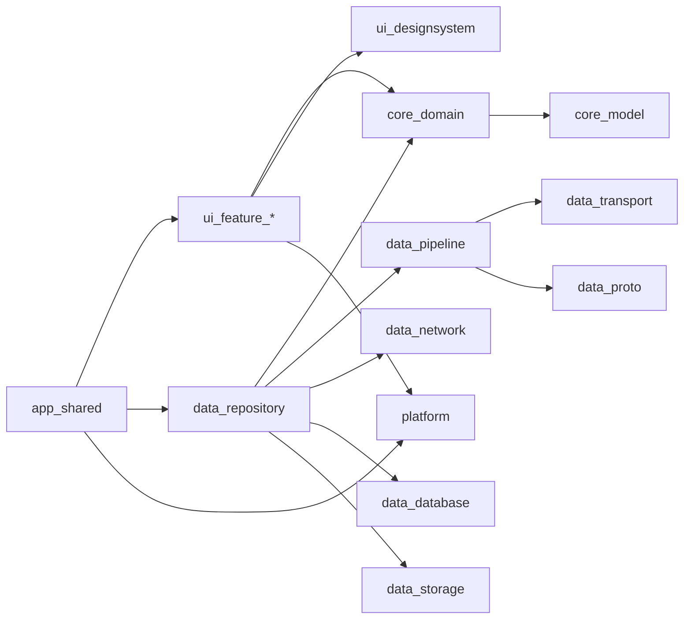

# 15 — KMP + Compose Multiplatform 跨平台客户端技术文档

> 目标：用 **Kotlin Multiplatform（KMP）+ Compose Multiplatform（CMP）** 构建一套跨平台 IM 客户端，**功能对标当前 iOS（UIKit）客户端**，协议与后端完全对齐。
> 对标基线：`ios/` 当前代码（而非仅 [10-ios-client-architecture.md](https://github.com/chaishuanzhu/GO-IM/blob/archive/ios-web/docs/10-ios-client-architecture.md) 的 P0 清单），含语音、视频、贴纸、@ 提及、下载进度、多账号隔离等后续补齐的能力。
> 后端契约：[07-api-reference.md](07-api-reference.md)、[`api/proto/message.proto`](../api/proto/message.proto)。
> 工程位置：仓库根目录 `kmp/`。原生 iOS（`ios/`）与 React Web（`web/`）客户端已下线，代码及其设计文档（10–14）归档在 [`archive/ios-web`](https://github.com/chaishuanzhu/GO-IM/tree/archive/ios-web) 分支，KMP 是唯一维护的客户端。

---

## 1. 目标与约束

| 项 | 约定 |
|----|------|
| 目标平台 | **Android**（minSdk 26）、**iOS**（16.0+）、**Desktop**（JVM：macOS / Windows / Linux） |
| 不做 | Web（Wasm）——React `web/` 客户端已归档；可在 M5 之后再评估 |
| 语言 | Kotlin 2.x（K2 编译器） |
| UI | Compose Multiplatform，**单套 UI 代码**，平台差异只在 `expect/actual` 与少量原生互操作视图 |
| 架构 | Clean Architecture：`domain` / `data` / `feature(ui)`，与 iOS 分层一一对应 |
| 消息处理 | **Netty 风格 Pipeline**（与 iOS `IMPipeline` 同构，可插拔 Handler） |
| 长连接 | **WS + TCP** 双通道，可在设置页切换 |
| 并发 | Kotlin Coroutines + Flow；Pipeline 单线程串行执行 |
| 构建 | Gradle（Kotlin DSL）+ Version Catalog + convention plugins |

**非目标（与 iOS 一致，首期不做）**：APNs / FCM 推送、E2EE、音视频通话、多账号**并行在线**（仍是切换式）、替换现有 UIKit iOS App。

**定位**：KMP 客户端是独立 App（独立 bundle id / applicationId）。现有 UIKit iOS 端继续维护；未来可评估让 UIKit 端复用 KMP 的 `data` 层（见 §14）。

---

## 2. 能力对标矩阵（iOS 现状 → KMP）

以 iOS 当前实现为准；「阶段」见 §13。

### 2.1 账号与连接

| 能力 | iOS 实现 | KMP 方案 | 阶段 |
|------|----------|----------|------|
| 登录 / 注册（dev_mode 无密码） | Moya `POST /login` `/register` | Ktor `submitForm` | M1 |
| 服务器地址设置（登录页入口） | `ServerSettingsViewController` | `ServerSettingsScreen` + multiplatform-settings | M1 |
| Token 安全存储 | Keychain `session.{uid}` | `expect SecureStore`：Keychain / Android Keystore+EncryptedPrefs / Desktop OS keyring（降级加密文件） | M1 |
| WS / TCP 双通道 + 设置页切换 | `NWWebSocketTransport` / `NWTCPTransport` | `expect/actual` Transport（§5） | M1 |
| 断线重连（指数退避 1→30s ±20%） | `ReconnectPolicy` | `commonMain` 同算法 | M1 |
| 应用层心跳 25s，连续 3 次失败断链 | `ConnectionRepositoryImpl` | 同参数，`commonMain` | M1 |
| 前台/网络恢复触发重连 | `NWPathMonitor` + `sceneDidBecomeActive` | `expect NetworkMonitor` + `AppLifecycle`（`ProcessLifecycleOwner` / `UIApplication` 通知 / 窗口焦点） | M1 |
| `authExpired` 熔断（停止重连回登录） | `ConnectionState.authExpired` | 同状态机 | M1 |
| `CmdKick` 被踢登出 | `CmdDispatchHandler` → `.kick` | 同 | M1 |
| 重连后补齐（Offline + UnreadCount + 当前会话 History + 重发 sending） | 已实现 | 同流程 | M1 |
| 多账号本地数据隔离 `Users/{uid}/` | [docs/11](https://github.com/chaishuanzhu/GO-IM/blob/archive/ios-web/docs/11-ios-multi-account-isolation.md) | `UserHome` 同布局，平台根目录不同（§8.3） | M4 |

### 2.2 会话与消息

| 能力 | iOS 实现 | KMP 方案 | 阶段 |
|------|----------|----------|------|
| 会话列表（单聊 + 群聊混排、未读角标、预览） | `ConversationListViewController` | `LazyColumn` + `ConversationListViewModel` | M1 |
| 删除会话 | `deleteConversation` | 同（滑动删除 / 右键菜单） | M2 |
| 文本收发 + 发送中 / 失败 / 重试 | `MessageStatus` + 失败按钮 | 同状态机 | M1 |
| 历史分页（上拉加载，保持滚动位置） | `loadOlderIfNeeded` + `didPrependHistory` | `LazyColumn(reverseLayout)` + 稳定 key | M1 |
| 离线消息 `CmdOffline` | 已实现 | 同 | M1 |
| 已读回执 / 未读计数 | `CmdReadReceipt` / `CmdUnreadCount` | 同 | M2 |
| 群聊收发 | `chat_type=2`，`to=g_*` | 同 | M2 |
| 群系统通知（加入 / 离开） | `SystemMessageContentView` | `SystemMessageContent` | M2 |
| 未知 `msg_type` 占位 | `MsgType.unsupported` + 升级提示 | 同 | M1 |
| 已撤回状态展示 | `.recalled` 显示「已撤回」 | 同（仅展示） | M2 |

### 2.3 富媒体

| 能力 | iOS 实现 | KMP 方案 | 阶段 |
|------|----------|----------|------|
| 图片：相册多选（≤9）、原图开关、相机拍照 | `ChatImageAccessoryPanel` + PHPicker / UIImagePicker | 图片面板 + `expect MediaPicker` / `CameraCapture` | M3 |
| 图片压缩（预览 1280px/0.7；发送 0.72 起，1600px 降级，原图 0.92，≤10MB） | `ImageCompressor` | `expect ImageCodec`，**参数完全对齐** | M3 |
| 系统相册受限访问提示（黄条） | 黄色 tip bar | iOS 同；Android 14 部分照片权限同样展示；Desktop 无 | M3 |
| 视频选择发送 + 播放 | PHPicker + AVPlayer | `expect VideoPlayer`（AVPlayer / Media3 ExoPlayer / Desktop 系统播放器打开） | M3 |
| 文件选择发送 + 下载进度 + 预览 | UIDocumentPicker + `FileDownloadCenter` + Quick Look | FileKit 选择 + `FileDownloadCenter`（common）+ `expect FileOpener` | M3 |
| 语音录制（AAC m4a，16kHz，单声道，32kbps）+ 波形 + 播放 | `VoiceRecorder` / `VoicePlayer` / 波形视图 | `expect AudioRecorder` / `AudioPlayer`，波形用 Compose Canvas | M3 |
| 贴纸（OSS catalog + 内置包 + 最近使用，`msg_type=6`） | `StickerRepositoryImpl` | `commonMain` 同实现（Ktor + Okio 落盘），GIF/WebP 动图解码见 §9 | M3 |
| Emoji 面板 | `EmojiAccessoryPanel` | 同 | M3 |
| 图片 / 视频 / 文件预览 | `MediaPreview`（缩放、视频、QuickLook） | `MediaPreviewScreen`（zoomable 图片 + VideoPlayer + FileOpener） | M3 |
| 带 token 的 `/file` 缩略图 / 原图加载 | Kingfisher | Coil 3（URL 拼 `uid`+`token`） | M3 |

### 2.4 社交与其他

| 能力 | iOS 实现 | KMP 方案 | 阶段 |
|------|----------|----------|------|
| 好友列表 / 新的朋友 / 发起与处理请求 | Contacts + NewFriends | 同（HTTP `/friend/*` + Cmd 20/21） | M2 |
| 好友选择器（建群、邀请） | `FriendPickerViewController` | `FriendPickerScreen` | M2 |
| 群列表 / 建群 / 加群 / 群资料（成员、邀请、退群） | Groups + GroupInfo | 同 | M2 |
| 群聊 @ 提及选择 | `MentionPickerViewController` | `MentionPickerSheet` | M3 |
| 消息搜索（Cmd 11 + `GET /search`）并跳转会话 | `SearchViewController` | `SearchScreen` | M2 |
| 设置：传输方式、连接状态、退出登录 | `SettingsViewController` | `SettingsScreen` | M1 |
| 开发者工具（FLEX） | `FLEXSupport`（Debug） | Debug 菜单：日志查看（Kermit）、网络日志、DB 导出；Android 可选 Chucker | M4 |
| 主导航 4 Tab：会话 / 通讯录 / 搜索 / 设置 | `MainTabBarController` | 手机：`NavigationBar`；平板/桌面：`NavigationRail` + 列表-详情双栏 | M1 / M4 |

### 2.5 对标之外（与 iOS 同为后续）

撤回（Cmd 19）、Typing（22）、转发（23）、编辑（24）——服务端与 Web 已支持，iOS 也未做。KMP 在 M5 实现，可反向成为 iOS 的参考（§13）。

---

## 3. 技术选型

> 下表为选型；实际版本锁定在 `kmp/gradle/libs.versions.toml`（M0：Kotlin 2.2.20、AGP 8.11.1、Compose Multiplatform 1.9.3、Ktor 3.2.3、Wire 5.4.0、Room 2.8.3、Gradle 8.14.3 / JDK 17–21）。

| 领域 | 选型 | 说明 / 替代 |
|------|------|-------------|
| UI | Compose Multiplatform（Material 3） | iOS 端已稳定；自建 `designsystem` 主题对齐 iOS 视觉（气泡色、圆角） |
| 导航 | JetBrains `navigation-compose`（类型安全路由） | 替代：Decompose（更强的生命周期控制） |
| ViewModel | JetBrains `lifecycle-viewmodel-compose` | KMP 官方移植 |
| DI | Koin | 轻量，KMP 成熟 |
| HTTP | Ktor Client（OkHttp / Darwin / OkHttp-JVM 引擎） | 对应 iOS Moya |
| WebSocket | Ktor `WebSockets` 插件 | iOS 端 Darwin 引擎底层为 `URLSessionWebSocketTask` |
| TCP | `expect/actual`：JVM/Android 用 `ktor-network`；iOS 用 **Network.framework**（cinterop `platform.Network`） | 与 iOS 端保持同一系统网络栈与路径感知；fallback 可用 `ktor-network` posix 实现 |
| Protobuf | **Square Wire**（KMP 代码生成，源为 `api/proto/message.proto`） | 替代：kotlinx-serialization-protobuf |
| JSON | kotlinx.serialization | 文件元数据、贴纸、群通知、搜索等 `content` JSON |
| 本地库 | **Jetpack Room（KMP）** + `androidx.sqlite` `BundledSQLiteDriver` | Android / iOS / JVM 共用实体与 DAO；KSP 生成代码；`Flow` 观察查询；三端打包同一版本 SQLite，行为一致 |
| 文件 IO | Okio | `UserHome` 目录、临时区、下载 |
| 图片加载 | Coil 3（Compose + Ktor 网络层） | 对应 Kingfisher；动图见 §9 |
| 文件选择 | FileKit | 相册 / 文件 / 保存，跨三端 |
| KV 设置 | multiplatform-settings | `device.json` 等价物 |
| 时间 | kotlinx-datetime | |
| 日志 | Kermit | Debug 面板读取环形缓冲 |
| Swift 互操作 | SKIE（可选） | 仅在 §14「UIKit 端复用 data 层」时需要 |
| 测试 | kotlin-test、Turbine、Ktor `MockEngine`、Room `inMemoryDatabaseBuilder` | |

---

## 4. 工程结构

```
kmp/
  settings.gradle.kts
  gradle/libs.versions.toml
  build-logic/                       # convention plugins：kmp-library、kmp-compose、android-app …
  core/
    model/        (commonMain)       # 实体：User, Message, Conversation, Group, Friend, FileMeta, StickerRef …
    domain/       (commonMain)       # Repository 接口 + UseCase；不依赖 Compose / Ktor / Room
    common/       (commonMain)       # Result、DispatcherProvider、时间、ID 工具（ConversationID 等）
  data/
    proto/                           # Wire 生成 + MessageCodec + Cmd 常量
    pipeline/                        # IMPipeline + Handlers
    transport/                       # Transport 接口 + WS(Ktor) + TCP(expect/actual)
    network/                         # Ktor HTTP API（auth/group/friend/upload/file/search）
    database/                        # Room：@Entity / @Dao / AppDatabase + 迁移 + schema 导出
    storage/                         # UserHome、LocalMediaStore、FileDownloadCenter、SecureStore
    stickers/                        # 贴纸 catalog / 包下载 / 最近使用
    repository/                      # *RepositoryImpl 编排
  platform/                          # expect/actual：媒体选择、相机、录音、播放、图片编解码、文件打开、网络监听、生命周期
  ui/
    designsystem/                    # 主题、颜色、气泡样式、通用组件
    feature-auth/                    # 登录 / 注册 / 服务器设置
    feature-conversations/
    feature-chat/                    # 聊天页：bubble / composer / events（§7）
    feature-contacts/                # 好友、新朋友、群列表、群资料、选择器
    feature-search/
    feature-settings/
  app/
    shared/                          # Composition root（Koin modules）、App() 根 Composable、导航图
    android/                         # Application + MainActivity
    desktop/                         # main() + Window
  iosApp/                            # Xcode 工程壳：MainViewController = ComposeUIViewController { App() }
```

**依赖规则**（与 iOS「Presentation 不依赖 Data」一致）：



- `ui/feature-*` 只依赖 `core:domain` 与 `platform` 的**接口**，不依赖 `data:*`。
- `app:shared` 是唯一组装点（对应 iOS `CompositionRoot.swift`）。

---

## 5. 双通道 Transport

```kotlin
interface IMTransport {
    val kind: TransportKind                 // WEB_SOCKET / TCP
    val incoming: Flow<ByteArray>           // WS：一帧 = 一个 protobuf；TCP：原始字节流
    val state: StateFlow<TransportState>
    suspend fun start(endpoint: IMEndpoint)
    suspend fun send(bytes: ByteArray)
    suspend fun stop()
}
```

| 实现 | Android | iOS | Desktop |
|------|---------|-----|---------|
| `WebSocketTransport`（`commonMain`） | Ktor + OkHttp | Ktor + Darwin | Ktor + OkHttp |
| `TcpTransport`（`expect`） | `ktor-network` | `NWConnection`（cinterop） | `ktor-network` |

- WS：`ws(s)://{host}/ws?token={jwt}`，binary 帧。
- TCP：`{host}:8081`，`[4 字节大端长度][protobuf]`；连接后**首包** `CmdLogin` + JWT，等待 `CmdLoginResp`，超时视为鉴权失败 → `authExpired`。
- 端点由 `API_BASE_URL` 推导（与 iOS 相同：TCP 用 base URL 的 host + 8081）。
- 切换传输：停旧连接 → 重建 Pipeline（TCP 额外装 Length 编解码 Handler）→ 重连。

**连接状态机**（`ConnectionRepositoryImpl`，`commonMain`，参数与 iOS 一致）：

```
disconnected → connecting → connected
                   ↑            ↓ 写失败 / 3 次心跳无响应 / 远端关闭
              reconnecting ←────┘   退避 1s→2s→4s… 封顶 30s，±20% jitter
connecting/connected --鉴权失败--> authExpired（不再重连，回登录页）
connected --CmdKick--> 登出（不重连）
```

---

## 6. Netty 风格 Pipeline（Kotlin 版）

与 iOS `IMPipeline` 同构，业务扩展 = 插 Handler。

```kotlin
interface IMHandler { val name: String }

interface InboundHandler : IMHandler {
    suspend fun channelRead(ctx: HandlerContext, msg: Any)
}

interface OutboundHandler : IMHandler {
    suspend fun write(ctx: HandlerContext, msg: Any)
}

class IMPipeline(dispatcher: CoroutineDispatcher) {
    fun addLast(handler: IMHandler)
    fun addAfter(name: String, handler: IMHandler)
    suspend fun fireRead(bytes: ByteArray)
    suspend fun write(envelope: OutboundEnvelope)
}
```

**线程模型**：Pipeline 跑在 `Dispatchers.Default.limitedParallelism(1)` 上，等价于 Netty EventLoop / iOS 串行 actor；数据库读写走 Room 的查询协程上下文（`setQueryCoroutineContext(Dispatchers.IO)`）；UI 仅通过 `StateFlow` 观察。

| Handler | 方向 | 作用（与 iOS 对应） |
|---------|------|------|
| `LoggingHandler` | 双 | Debug 日志 |
| `LengthFrameDecoder` / `Encoder` | 入 / 出 | 仅 TCP：粘包拆包 |
| `ProtobufDecode` / `Encode` | 入 / 出 | Wire `Message` ↔ `ByteArray` |
| `AuthLoginHandler` | 出 | TCP 连上即发 `CmdLogin` |
| `HeartbeatHandler` | 双 | 25s 心跳、失败计数 |
| `OutboundAckTracker` | 入 | 按 `seq` 匹配 `CmdAck`，超时标记 failed |
| `CmdDispatchHandler` | 入 | 按 `cmd` 转成 `InboundEvent`（下表） |

`InboundEvent`（对应 iOS 同名枚举）：

```kotlin
sealed interface InboundEvent {
    data class MessageReceived(val message: Message) : InboundEvent
    data class Ack(val seq: Long, val msgId: Long) : InboundEvent
    data object Kick : InboundEvent
    data class FriendRequest(val request: FriendRequest) : InboundEvent
    data class FriendResponse(val request: FriendRequest) : InboundEvent
    data class GroupUpdated(val group: Group) : InboundEvent
    data class SearchHits(val hits: List<SearchHit>, val finished: Boolean) : InboundEvent
    data class Unread(val counts: Map<String, Int>) : InboundEvent
    data class HistoryFinished(val delivered: Int) : InboundEvent
}
```

出站 `OutboundEnvelope` 与 iOS 一致：`Chat`、`File`、`Offline`、`History`、`ReadReceipt`、`UnreadCount`、`Heartbeat`、`GroupCreate/Join/Leave/Info/List/Invite`、`FriendRequest/Response`、`Search`。M5 再加 `Recall / Typing / Forward / Edit` Handler 与信封类型。

---

## 7. 聊天页架构（对齐 iOS docs 12–14）

iOS 已把聊天页拆成三块：气泡「壳 + 内容插件」（[12](https://github.com/chaishuanzhu/GO-IM/blob/archive/ios-web/docs/12-message-bubble-cell-refactor.md)）、输入栏「壳 + 附件面板插件」（[13](https://github.com/chaishuanzhu/GO-IM/blob/archive/ios-web/docs/13-composer-bar-refactor.md)）、页面事件 `ChatUIAction` + `ChatEventRouter`（[14](https://github.com/chaishuanzhu/GO-IM/blob/archive/ios-web/docs/14-chat-events-refactor.md)）。KMP 直接按这个结构落地，用 Compose 的单向数据流表达。

### 7.1 状态与事件（对应 ChatUIAction / ChatEventRouter）

```kotlin
data class ChatUiState(
    val conversation: Conversation,
    val messages: List<MessageItem>,       // 已映射的展示模型，含 stable key
    val loadingOlder: Boolean,
    val accessory: ComposerAccessory,      // NONE / EMOJI / VOICE / IMAGE / MORE
    val draft: TextFieldValue,
    val error: UiError?,
)

sealed interface ChatIntent {
    data class SendText(val text: String) : ChatIntent
    data class SendSticker(val ref: StickerRef) : ChatIntent
    data class SendVoice(val file: PlatformFile, val durationSec: Int) : ChatIntent
    data class ConfirmImages(val picks: List<PickedImage>, val original: Boolean) : ChatIntent
    data class SendVideo(val file: PlatformFile) : ChatIntent
    data class SendFile(val file: PlatformFile) : ChatIntent
    data class Retry(val messageId: String) : ChatIntent
    data class Preview(val item: MediaPreviewItem) : ChatIntent
    data class PlayVoice(val messageId: String) : ChatIntent
    data object OpenMentionPicker : ChatIntent
    data class InsertMention(val uid: String) : ChatIntent
    data class SetAccessory(val mode: ComposerAccessory) : ChatIntent
    data object LoadOlder : ChatIntent
}
```

- `ChatViewModel.onIntent(intent)` 等价于 `ChatEventRouter.handle(_:)`：调用 UseCase、更新 `ChatUiState`。
- 需要系统 UI 的副作用（打开相册、相机、文件选择、预览页、群资料页）通过 `Channel<ChatEffect>` 交给 Screen 层执行，对应 iOS 的 `ChatPresentationHosting`。
- Retry / Preview 只携带 `messageId` 或当时的 item，避免重组时捕获过期数据（与 iOS「Cell 复用捕获错消息」的对策一致）。

### 7.2 气泡：壳 + 内容注册表

```kotlin
sealed interface MessageContentModel {
    data class Text(val text: String) : MessageContentModel
    data class Image(val thumbUrl: String, val fullUrl: String, val width: Int?, val height: Int?) : MessageContentModel
    data class Voice(val url: String, val durationSec: Int) : MessageContentModel
    data class Video(val thumbUrl: String?, val url: String, val durationSec: Int?) : MessageContentModel
    data class File(val fileId: String, val name: String, val size: Long) : MessageContentModel
    data class Sticker(val ref: StickerRef) : MessageContentModel
    data class System(val text: String) : MessageContentModel
    data class Unsupported(val code: Int) : MessageContentModel
}

@Composable
fun MessageBubble(item: MessageItem, actions: MessageContentActions)   // 壳：对齐、头像、元信息、发送状态
```

- `MessageBubbleMapper`（`commonMain`，对应 iOS 同名类）把 `Message` → `MessageItem`，解析 `content` JSON。
- 内容渲染用 `when (model)` 分派到 `TextContent` / `ImageContent` …；新增消息类型 = 加一个 `MessageContentModel` 分支 + 一个 Composable，壳不改。
- 气泡最大宽度比例、圆角、颜色放在 `designsystem`，数值取自 iOS `GOIMStyle`。

### 7.3 输入栏：壳 + 附件面板

- `ChatComposer`：输入框（多行自增高，上限对齐 iOS 36–110pt）、工具按钮（Emoji / 语音 / 图片 / @ / 更多）、附件宿主。
- 附件面板：`EmojiPanel`（含贴纸 Tab）、`VoicePanel`、`ImagePanel`（相册条 + 相机 / 相册入口 + 原图开关 + 发送）、`MorePanel`（视频、文件）。
- 面板高度 = 最近一次键盘高度 + 底部安全区（与 iOS 相同策略），键盘与面板互斥。
- 键盘高度来源：`WindowInsets.ime`；首次没有键盘高度时使用平台默认值。

### 7.4 消息列表

- `LazyColumn(reverseLayout = true)`，`key = message.id`，最新消息在底部；进入会话自动在底部。
- 上拉到顶触发 `LoadOlder`；因为是 reverseLayout + 稳定 key，向前插入历史时滚动位置天然保持（iOS 端需要手算 contentOffset 的问题在这里不存在）。
- 新消息：用户在底部附近时自动滚到底；否则显示「新消息」提示。
- 点击空白收起键盘与附件面板。

---

## 8. 本地数据

### 8.1 Room KMP 数据库（表结构与 iOS GRDB 一致）

`data:database` 模块应用 KSP 与 Room Gradle 插件，`commonMain` 中定义实体、DAO 与数据库；KSP 为 `kspAndroid`、`kspIosArm64`、`kspIosSimulatorArm64`、`kspDesktop` 分别生成代码（不构建 `iosX64`，Desktop JVM 目标名为 `desktop`）。

```kotlin
@Database(
    entities = [
        MessageEntity::class, ConversationEntity::class, GroupEntity::class,
        GroupMemberEntity::class, FriendEntity::class, FriendRequestEntity::class, MetaEntity::class,
    ],
    version = 1,
    exportSchema = true,
)
@TypeConverters(EnumConverters::class)        // ChatType / MsgType / MessageStatus ↔ Int，数值与 iOS 一致
@ConstructedBy(AppDatabaseConstructor::class)
abstract class AppDatabase : RoomDatabase() {
    abstract fun messageDao(): MessageDao
    abstract fun conversationDao(): ConversationDao
    abstract fun groupDao(): GroupDao
    abstract fun friendDao(): FriendDao
    abstract fun metaDao(): MetaDao
}

@Suppress("NO_ACTUAL_FOR_EXPECT")
expect object AppDatabaseConstructor : RoomDatabaseConstructor<AppDatabase> {
    override fun initialize(): AppDatabase
}

@Dao
interface MessageDao {
    @Query(
        "SELECT * FROM messages WHERE conversation_id = :conversationId " +
            "AND timestamp_ms < :beforeMs ORDER BY timestamp_ms DESC LIMIT :limit"
    )
    suspend fun page(conversationId: String, beforeMs: Long, limit: Int): List<MessageEntity>

    @Query("SELECT * FROM messages WHERE conversation_id = :conversationId ORDER BY timestamp_ms DESC LIMIT :limit")
    fun observeLatest(conversationId: String, limit: Int): Flow<List<MessageEntity>>

    @Upsert
    suspend fun upsert(message: MessageEntity)

    @Query("UPDATE messages SET status = :status, server_msg_id = :serverMsgId WHERE client_seq = :clientSeq")
    suspend fun markStatus(clientSeq: Long, status: MessageStatus, serverMsgId: Long?)
}
```

**数据库构建**：各平台只负责给出文件路径，其余配置在 `commonMain` 统一完成。

```kotlin
// commonMain
fun buildDatabase(builder: RoomDatabase.Builder<AppDatabase>): AppDatabase =
    builder
        .setDriver(BundledSQLiteDriver())
        .setQueryCoroutineContext(Dispatchers.IO)
        .addMigrations(*AppMigrations.ALL)
        .build()

// androidMain：Room.databaseBuilder<AppDatabase>(context, userHome.dbFile.toString())
// iosMain / jvmMain：Room.databaseBuilder<AppDatabase>(name = userHome.dbFile.toString())
```

约束与约定：

- 非 Android 平台上 DAO 方法必须是 `suspend` 或返回 `Flow`，因此 **commonMain 中的 DAO 一律写成 suspend / Flow**，不写阻塞方法。
- 多步写入（收到消息 → 落库 → 更新会话预览与未读）放在 `database.useWriterConnection { it.immediateTransaction { … } }` 中，保证原子性。
- 历史分页用「`timestamp_ms` 游标 + `LIMIT`」手写查询，和 iOS 保持一致；不引入 Paging 库。
- `exportSchema = true`，Room Gradle 插件把每个版本的 schema JSON 输出到 `data/database/schemas/`，纳入版本库，用于迁移评审与 `MigrationTestHelper` 测试。
- 迁移：简单加列用 `@AutoMigration`；改表结构手写 `Migration`（基于 `SQLiteConnection` API，三端通用）。禁止 `fallbackToDestructiveMigration`（会丢本地聊天记录）。
- 复合主键：`group_members(group_id, uid)`、`friend_requests(from_uid, to_uid)`；索引：`messages.conversation_id`、`messages.timestamp_ms`、`messages.server_msg_id`（唯一）。

| 表 | 关键列 |
|----|--------|
| `messages` | `id` PK、`server_msg_id` UNIQUE、`client_seq`、`conversation_id`（索引）、`from_uid`、`to_uid`、`chat_type`、`msg_type`、`content`、`timestamp_ms`（索引）、`status`、`is_outgoing` |
| `conversations` | `id`（`dm:{a}_{b}` / `group:{gid}`）、`chat_type`、`title`、`peer_or_group_id`、`last_msg_preview`、`last_msg_at`、`unread_count` |
| `groups` | `group_id`、`name`、`owner_uid`、`member_count` |
| `group_members` | `group_id`、`uid`、`role` |
| `friends` | `uid`、`username` |
| `friend_requests` | `from_uid`、`to_uid`、`status`、`created_at`、`username` |
| `meta` | `key`、`value` |

- 会话 ID 规则与 iOS `ConversationID` 相同：单聊按 UID 排序拼接，群聊 `group:{gid}`。
- `MessageStatus`：`sending=0`、`sent=1`、`failed=2`、`recalled=3`（数值与 iOS 一致，便于将来数据迁移与对照调试）。
- 策略不变：先读本地分页 → `CmdHistory` 补齐；发送先落库 `sending`；连上后 `CmdOffline`。

### 8.2 `content` JSON 约定

全部用 `@Serializable` 数据类在 `core:model` 中定义，字段名与 iOS / 服务端一致：

- 文件类（`msg_type` 2–5）：`file_id`、`name`、`size`、`mime`、`width`、`height`、`thumb_width`、`thumb_height`、`duration`（兼容整数与浮点）。
- 贴纸（`msg_type=6`）：`pack_id`、`sticker_id`、`format`、`width`、`height`、`url?`。
- 群通知、搜索参数、未读计数：见 [07 §10](07-api-reference.md)。
- 会话预览文案（`[图片]`、`[语音] 3"`、`[视频]`、`[文件]`、`[表情]`）复刻 iOS `MessagePreview`。

### 8.3 多账号目录隔离

布局与 [docs/11](https://github.com/chaishuanzhu/GO-IM/blob/archive/ios-web/docs/11-ios-multi-account-isolation.md) 完全一致，只是根目录随平台变化：

| 平台 | 根目录 |
|------|--------|
| Android | `context.filesDir/GOIM/` |
| iOS | `Application Support/GOIM/` |
| Desktop | 用户数据目录（macOS `~/Library/Application Support/GOIM`，Windows `%APPDATA%/GOIM`，Linux `$XDG_DATA_HOME/goim`） |

```
GOIM/
  Shared/device.json          # activeUID、apiBaseURL、preferredTransport
  Users/{uid}/db/goim.db
  Users/{uid}/media/  files/  tmp/
  Catalog/Stickers/
```

切换账号：断连 → `AppDatabase.close()` → 清图片内存缓存 → 按新 UID 重建 Koin 的「用户作用域」（DB、Repository、Pipeline）→ 进入主页。退出登录不删除 `Users/{uid}`。

---

## 9. 平台能力（expect / actual）

| 接口 | Android | iOS | Desktop |
|------|---------|-----|---------|
| `SecureStore` | Keystore + EncryptedSharedPreferences | Keychain | OS keyring（降级：加密文件） |
| `MediaPicker`（图片多选 ≤9、视频） | Photo Picker（`PickMultipleVisualMedia`） | `PHPickerViewController` | FileKit 文件对话框 |
| `CameraCapture` | `ActivityResultContracts.TakePicture` | `UIImagePickerController` | 不支持（入口隐藏） |
| `PhotoAccessState`（受限提示条） | Android 14 部分访问 | `PHPhotoLibrary` limited | 无 |
| `ImageCodec`（缩放 + JPEG 压缩） | `Bitmap` | `UIImage` / ImageIO | `ImageIO` |
| `AudioRecorder`（AAC m4a 16kHz 单声道 32kbps） | `MediaRecorder` | `AVAudioRecorder` | M4 再评估（JavaSound 录 PCM 后编码） |
| `AudioPlayer` | Media3 ExoPlayer | `AVPlayer` | JavaFX Media / VLCJ |
| `VideoPlayer`（Composable） | Media3 `PlayerView`（`AndroidView`） | `AVPlayerViewController`（`UIKitViewController`） | 交给系统播放器打开 |
| `FileOpener`（预览 / 用其他应用打开） | `Intent.ACTION_VIEW` + FileProvider | `QLPreviewController` | `Desktop.open()` |
| `BackgroundDownloader` | WorkManager | `URLSession` 后台会话 | 协程 + 进度 |
| `NetworkMonitor` | `ConnectivityManager` | `NWPathMonitor` | 轮询 / 连接失败触发 |
| `AppLifecycle` | `ProcessLifecycleOwner` | `UIApplication` 通知 | 窗口焦点 |
| 动图贴纸（GIF / WebP） | Coil GIF 解码器 | 自定义 Coil `Decoder`（ImageIO 逐帧） | Skia 动图 |

**权限**：相机、麦克风、相册在各平台 manifest / Info.plist 中声明，统一用 `PermissionController`（`expect`）请求。

---

## 10. HTTP API（Ktor）

| 分组 | 接口 |
|------|------|
| 认证 | `POST /login`、`POST /register`（表单） |
| 健康 | `GET /health` |
| 群 | `POST /group/create|join|leave`、`GET /group/members`、`GET /group/list` |
| 好友 | `POST /friend/request|accept|reject|remove`、`GET /friend/list` |
| 文件 | `POST /upload`（multipart：uid / token / file）、`GET /file?id=&thumb=1&uid=&token=` |
| 搜索 / 未读 | `GET /search`、`GET /unread` |
| 贴纸 | OSS `catalog.json` + 包下载（与 iOS 默认 catalog 地址一致，可配置） |

- 错误映射到 `DomainError`（`NotAuthenticated` / `Network` / `Server(code, body)` / `Persistence` / `InvalidState` / `Cancelled`），文案与 iOS 相同。
- 上传使用 `onUpload` 进度回调驱动气泡上的进度；下载使用 `onDownload` + `FileDownloadCenter` 的 `Flow<FileDownloadEvent>`（`Progress` / `Completed` / `Failed`）。

---

## 11. UI 与平台适配

- **主题**：Material 3 + 自定义颜色 token，对齐 iOS 气泡色与字号；支持深色模式。
- **自适应布局**：`WindowSizeClass`
  - Compact（手机）：底部 4 Tab，聊天全屏 push。
  - Medium / Expanded（平板、桌面）：左侧 `NavigationRail` + 会话列表 / 聊天双栏。
- **桌面专属**：回车发送、Shift+回车换行；右键菜单（复制、重试、删除会话）；拖拽文件到聊天区发送；窗口最小尺寸。
- **iOS 专属注意**：中文输入法 marked text 与 `TextField` 交互需重点测试；安全区与 home indicator 用 `WindowInsets.safeDrawing`；边缘右滑返回由导航库处理。
- **Android 专属**：edge-to-edge、预测性返回手势、`imePadding()`。

---

## 12. 测试策略

| 层 | 内容 | 工具 |
|----|------|------|
| `core:domain` | UseCase + 假 Repository | kotlin-test、Turbine |
| `data:proto` | 与 iOS `ProtobufCodec` / Go 服务端的**线上字节兼容**：同一 `Message` 在三端编码结果一致（用固定样本做黄金测试） | kotlin-test |
| `data:pipeline` | 长度帧拆包粘包、Ack 匹配与超时、Kick、心跳失败断链、各 Cmd 分派 | 假 Transport |
| `data:network` | 各接口请求参数与错误映射 | Ktor `MockEngine` |
| `data:database` | DAO 查询、分页、未读、upsert 幂等、事务原子性；每个版本迁移（基于导出的 schema） | Room `inMemoryDatabaseBuilder` + `BundledSQLiteDriver`、`MigrationTestHelper` |
| `ui:feature-*` | ViewModel 状态流转（发送、重试、历史前插、附件互斥） | Turbine |
| 集成 | 对本地 `go run ./cmd/gateway/`：登录 → WS/TCP 单聊 → 群聊 → 上传 → 搜索 → 断线重连补齐 | JVM 测试任务 |
| 互通 | KMP（Android）与 iOS UIKit 端、Web 端互发全部消息类型，确认双方正确渲染 | 手工清单（§13 验收） |

---

## 13. 分阶段交付

| 阶段 | 内容 | 验收 |
|------|------|------|
| **M0 脚手架** | Gradle 多模块、convention plugins、Wire 生成、三端空壳 App 可运行、CI（`./gradlew check` + iOS framework 构建） | 三端启动显示空白主页 |
| **M1 核心链路** | 登录 / 注册 / 服务器设置、SecureStore、WS+TCP Transport、Pipeline、重连 / 心跳 / authExpired / Kick、Room 数据库（v1 schema 导出）、会话列表、单聊文本、历史分页、离线、设置页 | 与 iOS 端互发文本；切换 WS/TCP；断网恢复后补齐 |
| **M2 社交** | 群聊（收发、通知、建群 / 加群 / 群资料 / 邀请 / 退群）、好友（列表、请求、处理、选择器）、已读 / 未读、搜索并跳转、删除会话 | 与 iOS 端群聊互通；未读角标一致 |
| **M3 富媒体** | 上传 / 下载进度、图片（多选、原图、相机、压缩、预览）、视频、文件（预览 / 打开）、语音（录制、波形、播放）、贴纸（catalog、动图、最近使用）、Emoji、@ 提及 | iOS 发送的每种消息在 KMP 正确展示，反之亦然 |
| **M4 打磨与对标收尾** | 多账号隔离与切换、平板 / 桌面双栏、桌面快捷键与拖拽、开发者菜单、性能（长列表、图片内存）、无障碍、深色模式 | §2 矩阵全部勾选 |
| **M5 超越对标（P1）** | 撤回（长按菜单）、转发、编辑、Typing；视情况评估 FCM / APNs | 与 Web 端行为一致 |

---

## 14. 与现有 iOS 端的关系

- **短期**：两套 iOS 客户端并存——UIKit 版（当前主力）与 KMP 版（新 bundle id，TestFlight 内测）。协议、`content` JSON、本地表结构、状态枚举值三方保持一致。
- **中期（可选）**：若 KMP `data` 层稳定，可把 `core:domain` + `data:*` 打成 XCFramework，经 SKIE 把 `Flow` / `suspend` 暴露为 Swift `AsyncSequence` / `async`，让 UIKit 端逐步替换自己的 Data 层，实现「UI 原生、逻辑共享」。是否走这一步在 M4 结束时根据 KMP 版 iOS 的输入法、滚动性能和包体积评估。
- **新功能**：M5 之后新增的协议能力（撤回、转发等）优先在 KMP 共享层实现，iOS UIKit 端按需复用或参照。

---

## 15. 风险与对策

| 风险 | 影响 | 对策 |
|------|------|------|
| CMP iOS 文本输入（中文输入法、光标、长按菜单）体验不如原生 | 聊天核心体验 | M1 即做输入专项测试；必要时输入框用 `UIKitView` 包装原生 `UITextView` |
| CMP iOS 长列表滚动与图片解码性能 | 卡顿 | 稳定 key、缩略图优先、限制 Coil 内存缓存、Release 包实测 |
| iOS TCP 走 cinterop Network.framework 的实现成本 | M1 进度 | 先用 `ktor-network` 跑通，再替换为 `NWConnection` 实现，接口不变 |
| 后台下载在 iOS 需 `URLSession` 后台会话，Ktor 无法覆盖 | 大文件下载中断 | `BackgroundDownloader` 走 `expect/actual`，iOS 直接用原生 API |
| 三端录音格式一致性 | 语音互通失败 | 统一 AAC/m4a、16kHz、单声道；Desktop 录音推迟到 M4 |
| iOS 包体积增加（Compose 运行时 + Skia） | 安装体积 | 开启 Release 优化与 dead code 剥离，M0 记录基线 |
| 动图贴纸在 iOS / Desktop 的 Coil 支持不完整 | 贴纸不动 | 自定义解码器；最差降级为首帧静态图 |
| Wire 编码与 iOS 手写 codec 的字段差异（默认值、零值省略） | 互通问题 | 黄金字节测试（§12）覆盖每个 Cmd |

---

## 16. 关键决策（已确认）

1. 目标平台：Android + iOS + Desktop，**不含 Web**。
2. 网络：Ktor（HTTP + WS），TCP 用 `expect/actual`（iOS 走 Network.framework）。
3. 协议：Wire 生成，源为仓库内 `api/proto/message.proto`，不手写 codec。
4. 本地库：**Jetpack Room KMP**（`BundledSQLiteDriver`），表结构与 iOS GRDB 一致，schema 导出纳入版本库。
5. 聊天页按 iOS docs 12–14 的「气泡插件 / 输入栏插件 / 事件路由」结构落地，以 `UiState + Intent + Effect` 表达。
6. KMP 版是独立 App，首期不替换 UIKit iOS 端。
7. 撤回 / 转发 / 编辑 / Typing 放在 M5，作为超越当前 iOS 能力的部分。

已按 §13 从 M0 开始落地，工程位于 `kmp/`（见 `kmp/README.md`）。M0 只建立有实际内容的模块（`build-logic`、`data:proto`、`ui:designsystem`、`app:*`、`iosApp`），§4 其余模块随 M1 起逐步加入。

---

## 17. M1 落地记录

**状态：完成。** 三端（Android APK、Desktop、iOS Simulator framework）构建通过；`desktopTest` + `iosSimulatorArm64Test` 全绿。

**对本地网关联调**（`transport=both`，纯内存配置）由 `data:repository` 的 `GatewayE2ETest` 驱动真实 `SessionManager`：

| 场景 | 结果 |
|------|------|
| WS 用户 → TCP 用户文本，ACK → `sent`，对端未读 +1 | ✅ |
| TCP 用户 → WS 用户文本 | ✅ |
| 对端登出期间发送，重新挂载后 `CmdOffline` 补齐；本地库保留旧消息 | ✅ |
| 会话内 TCP → WS 切换后继续收发 | ✅ |
| 网关重启：`reconnecting` 指数退避 → 自动恢复 → 发送并收到 ACK | ✅ |
| 历史分页（`CmdHistory`） | 单测覆盖；服务端历史需 MySQL，本机无 Docker 未联调 |

**与前文设计的偏差：**

- **会话生命周期**：不用 Koin scope，改为 `SessionManager` / `UserSession` 显式持有每用户的数据库、连接、仓库；登出整体关闭。Koin 只管设备级单例。
- **Room 无 TypeConverter**：枚举列直接存 `Int`（与 iOS GRDB 数值一致）；库文件名 `goim.sqlite`（同 iOS），而非 `goim.db`。
- **Desktop SecureStore**：`java.util.prefs`（未加密，降级）；Android 为 EncryptedSharedPreferences，iOS 为 Keychain。
- **iOS TCP**：先用 `ktor-network`（§15 预案），尚未替换为 `NWConnection`。
- **前台 / 网络恢复**：`LifecycleResumeEffect` + `platform` 模块 `networkAvailability()`（Android `ConnectivityManager`、iOS `nw_path_monitor`、Desktop 恒为 true）触发 `ensureConnected()`；`RECONNECTING` 时立即重试而非等待退避。
- **会话预览**：较旧的历史消息不覆盖会话预览（iOS 会覆盖）。
- **已读回执**：聊天页打开期间收到新消息即发送已读回执。
- **Token 失效探测**：WS 握手 401 无法从 Ktor 异常区分，连接失败时以 `GET /unread` 探测 token，401 判定 `authExpired`。

**联调发现的服务端问题**：gnet 监听未设 `SO_REUSEADDR`（`gnet.WithReuseAddr`），网关重启时若 `:8081` 上有 `TIME_WAIT` 会 `bind: address already in use`，需等 TIME_WAIT 过期。

---

## 18. M2 落地记录

**状态：完成（好友 / 服务端搜索仅单测 + 降级路径联调）。** 三端构建、`./gradlew check`、`desktopTest` 全绿。

**范围**：群组（建群带成员 / 按 ID 加群 / 群信息 / 群主邀请 / 退群 / 群系统通知）、好友（通讯录按首字母分组、新的朋友、按 ID 加好友、接受 / 拒绝、好友选择器）、未读（会话未读 + 底部 Tab 角标）、消息搜索并跳转定位、删除会话（左滑 / 长按 / 右键菜单）。新增模块 `ui:feature-contacts`、`ui:feature-search`；首页四个 Tab：聊天 / 通讯录 / 搜索 / 设置。

**对本地网关联调**（纯内存配置，`GatewayE2ETest.groupsFriendsAndSearch`）：

| 场景 | 结果 |
|------|------|
| WS 用户建群并带上 TCP 用户；对方收到「加入了群聊」，群列表经事件刷新、会话标题同步 | ✅ |
| 群聊双向（WS ⇄ TCP）；未打开群聊方会话未读 = Tab 总未读 | ✅ |
| 第三人按 ID 加群，群内收到通知；成员列表正确 | ✅ |
| 非群主邀请被拒（「仅群主可以执行此操作」）；群主邀请成功，群内收到通知 | ✅ |
| 退群：其他成员收到「离开了群聊」；本地群列表移除、会话与记录保留（同 iOS） | ✅ |
| 搜索：网关无消息库时回退本机 | ✅ |
| 好友请求：网关无 MySQL 时 WS 静默丢弃 → 5 s 后 HTTP 求证 → 提示「服务端未启用该功能」 | ✅ |
| 好友请求 / 处理成功路径、服务端搜索 | 单测（MockEngine）覆盖；需 MySQL，本机无 Docker 未联调 |

**实现要点与偏差：**

- **群写操作走 HTTP**（`/group/create|join|leave|invite`）：同步拿到结果与错误码；群通知仍由服务端经长连接广播。WS 的 `CmdGroup*` 未使用。
- **群列表刷新**：群系统通知或未知群的群消息触发合并（conflated）刷新；重连补齐时也刷新。刷新整体替换本地群缓存并同步已有会话标题；建群 / 加群后立即插入会话行（`lastMsgAt = now`）以出现在列表顶部。
- **好友请求**：在线时先走 `CmdFriendRequest` 并等待服务端回执（5 s），未收到回执再用 HTTP 求证（409 视为已存在）；离线直接 HTTP。**处理请求**走 `CmdFriendResponse`，轮询刷新确认请求消失，否则回退 HTTP。收到 `CmdFriendRequest` 先落库待处理请求再刷新，角标即时出现。
- **搜索**：服务端优先；网络错误、5xx 或空结果时回退本机 Room `LIKE` 搜索，界面提示「仅显示本机记录」。400 / 401 / 403 / 429 直接报错。
- **搜索跳转**（iOS 无）：命中带 `serverMsgId` / 本地 ID / 时间戳；聊天页本地找不到时从命中时间点向前拉一页历史，再按「更晚消息数 + 一页」扩大窗口，滚动到该条并高亮 2 s。
- **群信息页**：群名、群 ID（点按复制）、群主、成员数、成员列表、邀请成员（仅群主可见）、复制群 ID、退出群聊（确认后返回进入群聊之前的页面）。
- **额外通知文案**：`member_kicked` / `group_renamed` / `owner_transferred`（iOS 未处理）。
- **Tab 角标**（iOS 无）：聊天 = 会话未读总和，通讯录 = 待处理好友请求数。
- **错误文案**：服务端英文纯文本错误统一映射为中文（`Throwable.userMessage()`）。

**联调发现的问题：**

- **iOS 端群邀请不可用**：iOS 走 WS 邀请，`content` 发送裸 UID；服务端期望 `{"target_uid": "..."}`。KMP 走 HTTP，不受影响。
- **被邀请人收不到入群通知**：服务端邀请时以被邀请人为 `from` 扇出，而扇出会跳过 `from`。被邀请人只能在下次群列表刷新（重连、打开群组页）时看到新群。
- **无消息库时搜索返回 200 + 空结果**：与「无命中」无法区分，客户端以空结果再查本机兜底。

---

## 19. M3 落地记录

**状态：数据链路完成并联调；UI 三端编译通过，未做真机 / iOS 端互发的人工验收。** 三端构建（`assembleDebug`、`:app:desktop` 编译、`:app:shared:linkDebugFrameworkIosSimulatorArm64`）、`./gradlew check iosSimulatorArm64Test`（261 个用例）全绿。

**范围**：文件上传 / 下载（带进度）、图片（多选 ≤ 9、原图开关、相机、压缩、全屏预览缩放）、视频、文件（下载后打开）、语音（按住录制、上滑取消、电平波形、播放）、贴纸（CDN catalog、动图、最近使用）、Emoji 面板、@ 提及（群成员 / 单聊对方与好友）。

**对本地网关联调**（`GatewayE2ETest.mediaUploadSendAndDownload`）：

| 场景 | 结果 |
|------|------|
| 图片：`SendFileMessageUseCase` 上传 → 对方收到 `Cmd.FILE`、宽高正确 → 下载原图与缩略图，字节一致 | ✅ |
| 语音：上传 `audio/mp4` + 时长 → 对方收到语音类型、时长保留 → 下载字节一致 | ✅ |
| 贴纸：`pack_id` / `sticker_id` 原样到达对方 | ✅ |
| iOS ⇄ KMP 互发各类型的人工验收 | 未做（`content` 字段与 iOS 编码对齐，有单测覆盖） |

**发送流程**：暂存为 `local:{UUID}` → 立即落库 SENDING 消息（气泡显示本地图与进度）→ 上传 → `content` 改写为服务端 `file_id` 后以 `Cmd.FILE` 发出 → 本地副本复制到 `media/` 或 `files/` → 删除暂存。多图先按顺序全部入库，再并行上传，保证列表顺序与选择顺序一致。上传失败标记 FAILED，重试重新上传；重连补齐时，未上传完的本地附件直接标记 FAILED，不会把 `local:` ID 发给服务端。

**实现要点与偏差：**

- **MIME 修正**：网关按内容嗅探 MIME，语音（m4a）会返回 `video/mp4` 或 `application/octet-stream`。客户端在本地 MIME 为 `audio/*`、或服务端返回 octet-stream / zip 时保留本地值。
- **图片压缩**：与 iOS 档位一致（4096 / 1600 / 1280 / 1024 逐级降质量，目标约 900 KB）；原图 q0.92、最长边 8192，超过 8 MB 时回落到普通档位。GIF 不压缩，原样发送。Android 按 EXIF 旋转；iOS 用 `UIGraphicsImageRenderer` 输出 JPEG（同时处理方向与 HEIC）。
- **视频**：从系统选择器选取，时长由 `MediaMetadataRetriever` / `AVURLAsset` 读取（桌面端无时长）；气泡为文件卡片样式，**没有封面缩略图**。
- **打开文件 / 视频**：iOS 用 Quick Look；Android 用 `FileProvider`（`${applicationId}.fileprovider`）交给外部应用；桌面用 `Desktop.open`。
- **语音**：Android `MediaRecorder`（AAC 16 kHz 单声道），iOS `AVAudioRecorder`；**桌面端暂不支持录音（M4）**，语音播放交给系统应用。不足 500 ms 提示「录音太短」。
- **动图贴纸**：Android 用 coil-gif（`AnimatedImageDecoder` / `GifDecoder`）；桌面与 iOS 用 Skia `Codec` 逐帧绘制。贴纸 catalog / manifest / 图片缓存在 `GOIM/Catalog/Stickers`，内置 iOS 同款预设 catalog，离线可用；最近使用存在 meta 表（`sticker.recent`，最多 20 个）。
- **相机**：仅 Android / iOS（FileKit）；桌面端隐藏「拍照」入口。
- **未做**：iOS 的相册缩略图横条与「有限访问」提示条；视频封面；桌面拖拽发送（M4）。
- **Info.plist 权限**（麦克风 / 相机 / 相册）加在 `iosApp/Project.swift`，修改后需重新 `tuist generate`。

---

## 20. M4 落地记录

**状态：完成（UI 未做真机 / 读屏人工验收）。** 三端构建（`assembleDebug`、`:app:desktop`、`:app:shared:linkDebugFrameworkIosSimulatorArm64`）、`./gradlew check iosSimulatorArm64Test`（290 个用例）全绿；桌面端启动冒烟通过。

**范围**：多账号切换、平板 / 桌面三栏、桌面快捷键与拖拽发送、桌面录音、开发者工具、外观（深色模式）、性能与无障碍整理。

| 能力 | 实现 |
|------|------|
| 多账号 | `device.json` 新增 `accounts`（最近使用在前）；凭据仍为 `session.{uid}`。设置 → 切换账号：列出已保存账号、一键切换（关库 / 断连后挂载目标账号，无需重新登录）、移除（删凭据，不删本地数据）、添加账号（卸载当前会话、保留凭据回登录页）。登录页列出本机已登录账号可直接进入。退出登录只删当前账号凭据。换号 / 登出时清 Coil 内存缓存。 |
| 自适应布局 | `BoxWithConstraints` 按宽度分档：< 600dp 底部 Tab；600–840dp 左侧 `NavigationRail` + 单栏；≥ 840dp `NavigationRail` + 列表（360dp）+ 聊天三栏（设置 Tab 占满右侧）。右栏聊天不入导航栈，用 `ScopedViewModelStore` 按会话隔离 ViewModel；窗口跨档位时当前聊天在「右栏」与「全屏入栈」之间迁移。会话列表高亮当前会话。 |
| 桌面快捷键 | ⌘/Ctrl+1…4 切 Tab，⌘/Ctrl+F 搜索，Esc 关闭右栏聊天；Enter 发送、Shift+Enter 换行（M1 已有）。 |
| 拖拽发送 | 桌面把文件拖到聊天区（高亮「松开发送文件」）：图片压缩发送（≤ 9 张），视频 / 其他文件逐个发送，超过 10MB 跳过并提示。 |
| 桌面录音 | JavaSound 录 16 kHz 单声道 16-bit PCM，写成 **WAV**（`audio/wav`，约 32 KB/s，上限 60 s）；WAV 语音在桌面内置播放（`Clip`，带进度），AAC 仍交给系统播放器。macOS 首次录音由系统弹窗授权。 |
| 开发者工具 | 设置 → 开发者工具：**日志**（Kermit 环形缓冲 2000 条，级别 / 关键字过滤）、**网络**（HTTP 请求摘要 tag `HTTP`，token / password 打码；长连接收发帧 tag `IM`）、**数据**（环境信息、立即重连、各表行数、`VACUUM INTO` 导出数据库快照并经系统保存对话框另存、media / files / tmp 占用、清除图片缓存）。 |
| 外观 | 设置 → 外观：跟随系统 / 浅色 / 深色（`device.json` `appearance`）；深色配色改为 iOS 蓝系（选中态不再用 M3 默认紫色）。 |
| 性能 | Coil 内存缓存限制为可用内存 15%，磁盘缓存 256MB（临时目录 `goim_image_cache`）；聊天 / 会话列表设置 `contentType` 复用节点；右栏切会话即清理旧 ViewModel。 |
| 无障碍 | 气泡合并语义（「发送者，内容，时间，状态」）；会话行朗读标题 + 未读数；失败重试 / 图片 / 语音 / 文件补充 `Role` 与操作标签；Tab 角标朗读；工具栏按钮选中态；@ 按钮标签；**按住说话**提供读屏替代操作（点按开始、再点按发送）；标题加 `heading`。 |

**偏差与未做：**

- **桌面语音为 WAV**：JVM 无 AAC 编码器，与移动端 m4a 不同；iOS / Android 均可播放 WAV，体积约为 AAC 的 8 倍（60 s ≈ 1.9 MB）。
- **开发者工具常驻设置页**（iOS FLEX 仅 Debug）：只读诊断 + 导出，不含敏感信息（token 打码）。
- **未做**：Android Chucker、桌面系统托盘 / 通知、Android 14 部分照片访问提示、读屏与深色模式的人工走查。
